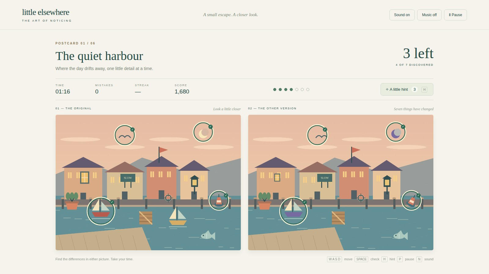

# Little Elsewhere

[](https://make.fun/bounty/best-spot-the-difference-game-20261121-0451)
[](https://make.fun/bounty/best-spot-the-difference-game-20261121-0451)
[](https://make.fun/bounty/best-spot-the-difference-game-20261121-0451)

A quiet game about the art of noticing. Explore six original, procedurally illustrated postcards, from a dusk harbour to a lantern-lit night market. Discover seven changing details in each scene, with two-stage hints, streak scoring, synthesized sounds, optional sequenced music, and a locally saved personal best. Built with Canvas 2D and plain JavaScript: no libraries, build step, or external game resources.



## What's in it

- **Six postcards** — harbour, kitchen, snowy lane, reef, conservatory, and a new night market with string lights and striped stalls. Every scene is drawn in code; nothing is borrowed.
- **Level select** — finish a postcard to unlock the next one. Revisit any unlocked postcard from the title screen; progress is saved locally.
- **Spread-out differences** — each visit picks seven details spread across the picture (farthest-point picking with a little jitter), so no round ever clumps in one corner, and replays still differ.
- **Five kinds of change** — a detail can be recoloured, vanished, shrunk, shifted, or tilted in the other picture.
- **Two-stage hints** — press H once and a quarter of the picture glows; press H again and the exact detail is ringed. Each stage costs one hint, and finishing a postcard earns one back (up to five).
- **Streak scoring** — finds within eight seconds of each other build a streak that multiplies the points. Fast, clean looking is worth more; a miss breaks the streak and adds five seconds.

## Controls

- **Click either picture** to check a detail.
- **Arrow keys / WASD** move the crosshair; hold **Shift** to move faster.
- **Space / Enter** check at the crosshair, or continue from a menu.
- **H** uses a hint (first press: zone, second press: pinpoint).
- **P / Esc** pause or resume.
- **M** toggles music; **N** toggles sound effects.

Misses add five seconds and a small score penalty. Several quick misses briefly lock clicks. Find all seven differences to collect a postcard; complete all six to see your final score.

## Run it

Use Node.js 22 or newer:

```sh
node serve.ts
```

Open http://localhost:8080 in desktop Chrome. Add `?seed=1` for a repeatable selection of differences.

Generate the submission dossier:

```sh
MAKEFUN_OUTPUT_DIR=out node main.ts
```

This writes `out/dossier.json` and copies the game and screenshots into `out/`.

For screenshot and gameplay verification, run Chrome with `--headless=new --remote-debugging-port=9222` while the local server is running, then run `node tools/check.mjs`. The helper reads `shots.json`, verifies the four staged views and a full playthrough of all six postcards, and captures unedited 1600×900 JPEGs into `screenshots/` (plus PNG checks in `/tmp/check/`). If the browser cannot reach localhost, point it at the game directory instead: `GAME_URL=file:///path/to/game node tools/check.mjs`.

---

Made for [make.fun](https://make.fun/?ref=vbrytm16).
